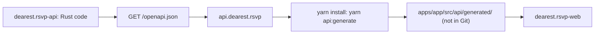

# dearest.rsvp-web

The web frontend for the dearest application. It uses React, Mantine, TanStack Query, TanStack Router, and Vite+.

The API is in the `dearest.rsvp-api` repository. The deployed API is `https://api.dearest.rsvp`.

## Repository layout

The repository uses yarn workspaces. Run all commands from the root.

- `apps/app/`: the builder. This is the app that couples use. Its `Dockerfile`, `nginx.conf` and `openapi-ts.config.ts` are in this folder.
- `packages/`: shared packages. The folder is empty now. The Text block slice of the guest sites design adds the first package.

## Setup

Use Node 24. The `.nvmrc` file has the version. Yarn comes from Corepack.

```bash
corepack enable
yarn install
git config core.hooksPath .githooks
```

The last command turns on the Git hooks. Run it one time in each clone.

## Update an old clone

The app moved to `apps/app/`. After you pull this change into an old clone, the old build files stay at the root.
The old API client stays in `src/api/generated/`. `yarn fmt:check` and the pre-commit hook fail while it exists.

Pull the change. Then delete the old API client and the old build output:

```bash
rm -rf src/api/generated dist
```

Delete the empty folders. This command does not delete a file:

```bash
find src -depth -type d -empty -delete
```

If `src/` stays, it holds other files. Run `find src -type f` to see them.
Move your own files to `apps/app/src/`. Delete a `.DS_Store` file. Then run the last command again.

Move your `.env.local` files to `apps/app/`, if you have them. Then run `yarn install`.

## Scripts

| Command             | What it does                                                                    |
| ------------------- | ------------------------------------------------------------------------------- |
| `yarn dev`          | Start the dev server                                                            |
| `yarn build`        | Typecheck and build for production                                              |
| `yarn preview`      | Serve the production build                                                      |
| `yarn test`         | Run the unit tests                                                              |
| `yarn typecheck`    | Run the TypeScript check                                                        |
| `yarn fmt`          | Format the code                                                                 |
| `yarn fmt:check`    | Check the format without a change                                               |
| `yarn api:generate` | Make the API client in `apps/app/src/api/generated/` from the deployed API spec |

## API client

The API sends its spec at `https://api.dearest.rsvp/openapi.json`.
`@hey-api/openapi-ts` makes the client in `apps/app/src/api/generated/` from that spec.
Git does not track `apps/app/src/api/generated/`. This repository keeps no copy of the spec.

`yarn install` runs `yarn api:generate`, so a new clone has the client after the install.
Run `yarn api:generate` again to get a new API version.
Set `OPENAPI_URL` to read the spec from another API:

```bash
OPENAPI_URL=http://localhost:3000/openapi.json yarn api:generate
```

The client always matches the deployed API. Deploy the backend first. Then use the
new API in this repository. A breaking change in the API makes `yarn typecheck`
fail here, so the type error shows the change at once.

`yarn install` and CI need network access to the deployed API. The install fails
if the API is down. The `publish` job in the backend repository checks that the
deployed spec is usable.

The generated code is the same for each repository that reads the same spec.
A new repository needs only the generator config and this URL.



Use the hooks in `apps/app/src/api/*.ts`. Do not use the generated query options in `apps/app/src/api/generated/@tanstack/react-query.gen.ts`. The generated error type is `ErrorBody`, but the run-time error is `ApiError`.

`apps/app/src/api/clientConfig.ts` configures the client. `apps/app/src/main.tsx` calls it one time.

The generator needs the JavaScript API of TypeScript 6. TypeScript 7 does not
have this API. `.yarnrc.yml` gives the generator a `typescript-6` package.
`apps/app/scripts/typescript-6-hooks.mjs` sends the generator imports to that package.
The hook was tested with `@hey-api/openapi-ts` 0.99.0. Remove the hook and the
`packageExtensions` entry in `.yarnrc.yml` when `@hey-api/openapi-ts` supports TypeScript 7.

## Environment variables

| Variable               | Used in      | Purpose                                                    |
| ---------------------- | ------------ | ---------------------------------------------------------- |
| `VITE_API_BASE_URL`    | Browser code | Base URL for API calls                                     |
| `DEV_API_PROXY_TARGET` | Dev server   | Where Vite sends `/api` calls. Default is `localhost:3000` |

`apps/app/.env.development` and `apps/app/.env.production` have the default values.
In development, the browser calls `/api`. Vite removes the `/api` prefix and forwards the call to `DEV_API_PROXY_TARGET`.
This avoids CORS in development.
In production, the browser calls `https://api.dearest.rsvp` directly. The API must allow the frontend origin with CORS.

## Pages

| Path                    | Who                 | Purpose                                                  |
| ----------------------- | ------------------- | -------------------------------------------------------- |
| `/login`                | logged out          | Log in with email and password                           |
| `/signup`               | logged out          | Create an account                                        |
| `/verify-email`         | unverified          | "Check your inbox", resend the email, log out            |
| `/verify-email/confirm` | anyone              | Open the link from the verification email                |
| `/forgot-password`      | logged out          | Request a password reset email                           |
| `/reset-password`       | anyone              | Set a new password from the reset email link             |
| `/invite/$token`        | anyone              | Join a wedding from an invite                            |
| `/onboarding`           | verified, 0 wedding | Create the first wedding                                 |
| `/new-wedding`          | verified            | Create another wedding. No link in the app points to it. |
| `/w/$tenantId`          | member              | Wedding home                                             |
| `/w/$tenantId/members`  | member              | Members, pending invites, and the invite form            |

`/` goes to the right page for the user: log in, verify the email, onboarding, or the wedding that was open last.
The session is an `HttpOnly` cookie from the API. The web app never reads a token.

## Local auth

The auth pages need the API and an email server. In the `dearest.rsvp-api` repository, on the `auth` branch, run:

```bash
docker compose up --build
```

This starts the API on `localhost:3000`, Postgres, and Mailpit. Then run `yarn dev` here.
The API sends all email to Mailpit. Open the Mailpit UI at `http://localhost:8025` to read the verification, reset, and invite emails.

## App layout

- `apps/app/src/api/`: the API layer. `client.ts` has `ApiError` and `parseBody`. `errors.ts` maps API error codes to messages. Each other file has the calls and hooks for one resource.
- `apps/app/src/router.tsx`: the routes and the route guards.
- `apps/app/src/routing.ts`: the redirect rules. Unit tests cover them.
- `apps/app/src/pages/`: one component for each page.
- `apps/app/src/components/`: shared React components.
- `apps/app/src/queryClient.ts`: the TanStack Query client.

## Git hooks

The `.githooks/pre-commit` hook runs `yarn fmt:check`. Run `yarn fmt` to fix a format error.
To skip the hook one time, add `--no-verify` to the Git command.

## CI

GitHub Actions makes the API client, runs the format check, the typecheck, the unit tests, and the build on each pull request and each push to `main`.
